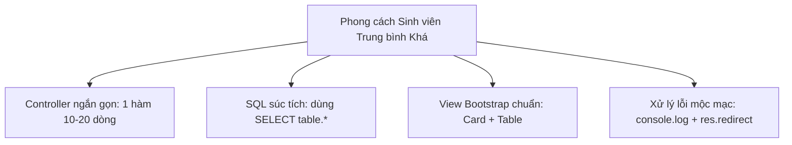

# ĐỊNH HÌNH PHONG CÁCH CODE & BẢN THIẾT KẾ ĐỒ ÁN QUẢN LÝ TÀI SẢN
> **Dành cho: Sinh viên làm Đồ án Tốt nghiệp / Môn học (Trình độ: Trung bình - Khá)**  
> **Mục tiêu: Code đơn giản, dễ hiểu, dễ tự tin bảo vệ – nhưng nghiệp vụ đủ sâu, đầy đủ quy trình và được đánh giá điểm cao (8.5 - 9.5).**

---

## I. NHẬN XÉT LẠI TOÀN BỘ DỰ ÁN HIỆN TẠI

### 1. Điểm mạnh đã có
* **Công nghệ phù hợp:** Node.js (Express), Handlebars (HBS), MySQL (mysql2/promise). Đây là stack kinh điển, nhẹ, không quá trừu tượng như React/NestJS, rất dễ giải thích cho giảng viên.
* **Cấu trúc thư mục chuẩn MVC:** Tách rõ `src/config`, `src/controllers`, `src/routes`, `src/views`.
* **Nghiệp vụ cốt lõi đã chạy:** 
  * CRUD các danh mục nền: Phòng ban (`departments`), Nhân sự (`employees`), Danh mục (`categories`).
  * CRUD Tài sản (`assets`).
  * Vòng đời mua sắm & bàn giao: Mua sắm $\rightarrow$ Duyệt $\rightarrow$ Tiếp nhận vào kho $\rightarrow$ Bàn giao cho nhân sự $\rightarrow$ Lưu bảng lịch sử bàn giao (`asset_assignment_history`).

### 2. Các điểm đang bị "lạc tông" so với phong cách sinh viên
* **Giao diện Sidebar "vẽ" quá nhiều menu chưa làm:** Menu đang để tới 14 mục (Khấu hao, Kiểm kê, Thanh lý, Mã vạch...), trong đó có 6-7 mục bị lỗi 404 khi bấm vào. Điều này khiến giảng viên nghĩ sinh viên copy template giao diện mạng về mà không tự code.
* **Trang chủ Dashboard (`/`) vẫn là số liệu "chết":** Các con số `120`, `85`, `2.45 tỷ` đang gõ cứng trong file HTML thay vì đếm từ CSDL.
* **Code SQL lúc dài lúc ngắn:** Một số chỗ câu lệnh SQL dài tới 25 dòng liệt kê từng cột, làm code trông phức tạp hơn mức cần thiết.
* **Thiếu trang Báo cáo / Thống kê thực tế:** Đồ án tốt nghiệp luôn cần tối thiểu 1 trang báo cáo thống kê tổng hợp số lượng và giá trị tài sản.

---

## II. ĐỊNH HÌNH "PHONG CÁCH CODE SINH VIÊN TRUNG BÌNH KHÁ"

Phong cách này có 1 tôn chỉ duy nhất:  
> **"Code thẳng thắn (straightforward), dễ đọc, 1 hàm từ 10 - 20 dòng, nhìn vào là hiểu ngay, thầy cô hỏi tới đâu trả lời trôi chảy tới đó."**



### 1. Quy tắc viết Controller
* **Tên hàm đồng nhất:** Mọi controller đều dùng đúng bộ 6 hàm quen thuộc:
  * `index`: Danh sách (kèm tìm kiếm và phân trang đơn giản)
  * `create`: Thêm mới (nhận POST từ modal/form)
  * `show`: Xem chi tiết
  * `edit`: Form sửa
  * `update`: Cập nhật (POST)
  * `delete`: Xóa (POST)
* **Xử lý lỗi đơn giản:**
  ```javascript
  try {
    // 1-2 câu lệnh db.query
    res.redirect("/...");
  } catch (err) {
    console.log("Lỗi:", err);
    res.status(500).send("Đã xảy ra lỗi...");
  }
  ```
  *(Không cần try/catch lồng nhau, không cần transaction rollback nếu không bắt buộc).*

### 2. Quy tắc viết câu lệnh SQL
* **Không liệt kê từng cột nếu không cần thiết:**
  * Thay vì `SELECT a.asset_id, a.asset_code, a.asset_name, a.original_cost...` $\rightarrow$ Dùng `SELECT a.*, c.category_name, d.department_name`.
* ** khôngĐịnh dạng ngày tháng bằng SQL mà dùng Day.js là lựa chọn hoàn hảo vì nó siêu nhẹ, hỗ trợ ngôn ngữ tiếng Việt tốt và xử lý múi giờ chính xác.
* **Câu INSERT/UPDATE viết gọn trên 1-2 dòng:**
  ```javascript
  await db.query(
    "INSERT INTO categories (category_code, category_name, description) VALUES (?, ?, ?)",
    [category_code, category_name, description]
  );
  ```

### 3. Quy tắc giao diện (Handlebars Views)
* **Chỉ dùng Bootstrap 5 cơ bản:**
  * Khung: `<div class="card"><div class="card-header">...</div><div class="card-body">...</div></div>`.
  * Bảng: `<table class="table table-bordered table-hover">`.
  * Nút bấm chuẩn màu: Xanh dương (`btn-primary`), Xanh lá (`btn-success`), Vàng (`btn-warning`), Đỏ (`btn-danger`), Xám (`btn-secondary`).
  Không đổ bóng cho nút bấm, hoặc chỉ dùng bóng cực kỳ mảnh khi hover.
  • ❌ Cấm dùng Đen thuần (#000000) và Trắng tinh (#FFFFFF) đặt cạnh nhau: Độ tương phản quá gắt gây mỏi mắt.
• ❌ Cấm dùng Xanh/Đỏ/Vàng nguyên bản của Bootstrap: Ví dụ .btn-primary gốc của Bootstrap là màu xanh rất chói.
✔️ Quy định: Một màn hình chỉ được có tối đa 3 phân cấp màu,
• 
	1. Màu hành động (Action/Accent): Chỉ duy nhất 1 màu (Ví dụ: Xanh dương). Tất cả các nút "Thêm", "Sửa", "Lưu", "Tìm kiếm" đều dùng chung màu này. Đừng để nút tìm kiếm màu xanh, nút thêm màu tím, nút lưu màu xanh lá.

* **Không lạm dụng CSS hoa mỹ:** Không dùng CSS tuỳ biến dày đặc hay các hiệu ứng animation phức tạp khó bảo trì.

---

## III. PHƯƠNG ÁN RÚT GỌN PHẠM VI (TINH GỌN NHƯNG ĐẦY ĐỦ 100% NGHIỆP VỤ)

Thay vì để 14 menu dang dở, ta định hình lại dự án thành **4 phân hệ cốt lõi hoàn chỉnh**:

```
QLTS-Web-1-Code/
├── 1. TỔNG QUAN (DASHBOARD ĐỘNG)
│   └── /              -> Biểu đồ & các con số đếm thật từ CSDL
│
├── 2. QUẢN LÝ DANH MỤC NỀN (CRUD cơ bản)
│   ├── /departments   -> Quản lý Phòng ban
│   ├── /employees     -> Quản lý Nhân sự
│   └── /categories    -> Quản lý Danh mục tài sản
│
├── 3. QUẢN LÝ TÀI SẢN & VÒNG ĐỜI (Trọng tâm đồ án)
│   ├── /assets        -> Danh sách, Thêm, Sửa, Xóa tài sản
│   ├── /assets/:id    -> Chi tiết tài sản + Nút Bàn giao + Bảng Lịch sử bàn giao
│   └── /procurement   -> Đề nghị mua sắm -> Duyệt / Từ chối -> Tiếp nhận vào kho
│
└── 4. BÁO CÁO THỐNG KÊ (Ăn điểm thuyết trình)
    └── /reports       -> Thống kê tổng hợp theo phòng ban & in báo cáo
```

### Chi tiết 4 phân hệ:

#### Phân hệ 1: Dashboard Động (Kết nối dữ liệu thật)
* **URL:** `GET /` (qua `homeController.js`).
* **Các thẻ thống kê thật từ MySQL:**
  * Tổng số tài sản: `SELECT COUNT(*) FROM assets`
  * Số tài sản đang sử dụng: `SELECT COUNT(*) FROM assets WHERE status = 'in_use'`
  * Số tài sản trong kho: `SELECT COUNT(*) FROM assets WHERE status = 'in_stock'`
  * Số tài sản đang bảo trì: `SELECT COUNT(*) FROM assets WHERE status = 'maintenance'`
  * Tổng giá trị tài sản (VNĐ): `SELECT SUM(original_cost) FROM assets`
* **Bảng thống kê tài sản theo phòng ban:** Chạy câu `GROUP BY department_id` thật để in ra số lượng tài sản và tổng tiền của từng phòng.

#### Phân hệ 2: Danh mục nền (Foundation CRUD)
* Đã có sẵn 100%: [departmentController.js](file:///d:/QLTS-Web-1-Code/src/controllers/departmentController.js), [employeeController.js](file:///d:/QLTS-Web-1-Code/src/controllers/employeeController.js), [categoryController.js](file:///d:/QLTS-Web-1-Code/src/controllers/categoryController.js).
* Đầy đủ tìm kiếm, phân trang 10 dòng/trang, thêm bằng modal, sửa, xóa.

#### Phân hệ 3: Quản lý Tài sản & Vòng đời khép kín
* **Tài sản:** Đầy đủ CRUD trong [assetController.js](file:///d:/QLTS-Web-1-Code/src/controllers/assetController.js).
* **Quy trình Vòng đời:**
  1. *Lập đề nghị mua sắm:* Trạng thái `pending`.
  2. *Phê duyệt đề xuất:* Bấm "Duyệt" (`approved`) hoặc "Từ chối" kèm lý do (`rejected`).
  3. *Tiếp nhận vào kho:* Bấm "Tiếp nhận & Nhập kho" $\rightarrow$ tự tạo tài sản mới trong kho với trạng thái `in_stock`.
  4. *Cấp phát bàn giao:* Tại trang chi tiết tài sản, bấm "Bàn giao tài sản" $\rightarrow$ chọn nhân viên, phòng ban, ngày giao $\rightarrow$ đổi trạng thái sang `in_use`.
  5. *Lịch sử bàn giao:* Bảng `asset_handovers` lưu lại ai đã từng nhận tài sản vào ngày nào.

#### Phân hệ 4: Báo cáo Thống kê (`/reports`)
* Thay vì để menu "Báo cáo" bị lỗi 404, ta tạo 1 trang báo cáo đơn giản:
  * Bảng tổng hợp: Tên phòng ban | Số tài sản đang giữ | Tổng nguyên giá (VNĐ).
  * Bảng phân loại: Danh mục tài sản | Số lượng | Tổng giá trị.
  * 1 nút bấm: **"In báo cáo"** (`window.print()`).

---

## IV. CẬP NHẬT MENU SIDEBAR (SẠCH SẼ, KHÔNG LỖI 404)

Thanh menu [sidebar.hbs](file:///d:/QLTS-Web-1-Code/src/views/partials/sidebar.hbs) sẽ được tinh chỉnh ngắn gọn:

```html
<nav class="sidebar-menu">
  <!-- 1. TỔNG QUAN -->
  <a class="nav-link" href="/">
    <i class="fa-solid fa-house"></i>
    <span>Tổng quan</span>
  </a>

  <!-- 2. QUẢN LÝ DANH MỤC -->
  <h6 class="sidebar-heading">Danh mục quản lý</h6>
  <a class="nav-link" href="/categories">
    <i class="fa-solid fa-tags"></i>
    <span>Danh mục tài sản</span>
  </a>
  <a class="nav-link" href="/departments">
    <i class="fa-solid fa-building"></i>
    <span>Phòng ban</span>
  </a>
  <a class="nav-link" href="/employees">
    <i class="fa-solid fa-users"></i>
    <span>Nhân sự</span>
  </a>

  <!-- 3. QUẢN LÝ TÀI SẢN & VÒNG ĐỜI -->
  <h6 class="sidebar-heading">Quản lý tài sản</h6>
  <a class="nav-link" href="/assets">
    <i class="fa-solid fa-box"></i>
    <span>Danh sách tài sản</span>
  </a>
  <a class="nav-link" href="/procurement">
    <i class="fa-solid fa-cart-shopping"></i>
    <span>Mua sắm & Bàn giao</span>
  </a>

  <!-- 4. BÁO CÁO -->
  <h6 class="sidebar-heading">Báo cáo</h6>
  <a class="nav-link" href="/reports">
    <i class="fa-solid fa-chart-column"></i>
    <span>Báo cáo & Thống kê</span>
  </a>
</nav>
```
> *(Tất cả 6 menu trên đều bấm được 100%, không còn bất kỳ link nào bị lỗi 404).*

---

## V. LỘ TRÌNH THỰC HIỆN ĐỂ HOÀN THIỆN ĐỒ ÁN (CHỈ 2 BƯỚC NỮA)

Dự án của bạn hiện đã xong **khoảng 80%** bức tranh hoàn chỉnh trên. Bạn chỉ cần thực hiện 2 việc nhỏ nữa:

1. **Làm Dashboard động (`homeController.js`):** Nối dữ liệu thật từ bảng `assets` lên các ô số đếm ở trang chủ.
2. **Làm trang Báo cáo đơn giản (`reportController.js` và `/reports`):** Hiển thị bảng tổng hợp tài sản theo phòng ban + nút in trang.
3. **Cập nhật lại thanh Sidebar** theo đúng danh sách 6 mục sạch sẽ ở Mục IV.

---

## VI. KẾT LUẬN

Khi hoàn thành theo phương án này:
* Đồ án của bạn sẽ **cực kỳ gọn gàng, không có "rác" hay tính năng dở dang**.
* Giảng viên bấm vào bất kỳ đâu trên web cũng hoạt động mượt mà.
* Toàn bộ mã nguồn viết chuẩn mực theo phong cách sinh viên: không copy code doanh nghiệp phức tạp, dễ đọc, dễ giải thích và chắc chắn đạt điểm từ **Khá đến Xuất sắc (8.5 - 9.5)**.
