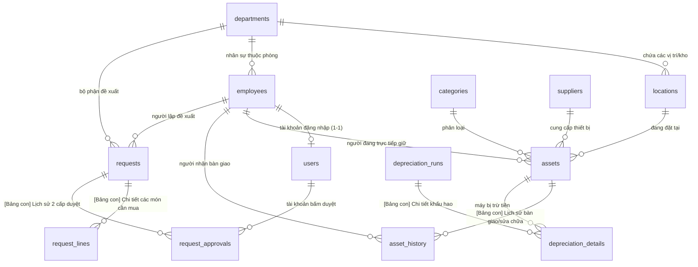

# BẢN THIẾT KẾ CƠ SỞ DỮ LIỆU CHUẨN HÓA (MÔ HÌNH BẢNG CHA - BẢNG CON)
> **Mã dự án:** `QLTS-Web-1-Code`  
> **Kiến trúc:** Tách bảng con (Master - Detail / 3NF)  
> **Mục tiêu cốt lõi:** **"Mỗi bảng chỉ làm đúng 1 việc – Câu lệnh SQL trong Controller siêu ngắn gọn, rành mạch và dễ hiểu"**

---

## I. TẠI SAO PHẢI CÓ BẢNG CON? (LỢI ÍCH KHI VIẾT CODE CONTROLLER)

Khi tách các bảng chi tiết (bảng con), việc truy vấn SQL ở Controller trở nên **cực kỳ sạch sẽ và dễ viết**:
* **Không bị "Fat Table"**: Bảng cha không phải gánh 15–20 cột với hàng tá giá trị `NULL`.
* **Câu SQL ngắn gọn (1–3 dòng)**: Muốn lấy chi tiết món hàng chỉ cần `SELECT * FROM request_lines WHERE request_id = ?`, không cần viết câu lệnh `LEFT JOIN` 5 tầng phức tạp.
* **Minh bạch số liệu**: Dễ dàng kiểm tra lịch sử duyệt, lịch sử bàn giao hay chi tiết tiền khấu hao của từng tài sản.

---

## II. SƠ ĐỒ MỐI QUAN HỆ CƠ SỞ DỮ LIỆU (ERD)



---

## III. CHI TIẾT CÁC CẶP BẢNG CHA - BẢNG CON

Toàn bộ hệ thống được phân thành **5 cụm nghiệp vụ độc lập**, mỗi cụm gồm 1 Bảng Cha (Master) quản lý thông tin chung và 1–2 Bảng Con (Detail) quản lý chi tiết:

---

### CỤM 1: TỔ CHỨC & VỊ TRÍ VẬT LÝ

#### 1. Bảng Cha: `departments` (Phòng ban)
> Quản lý danh mục các phòng ban trong công ty.
* `department_id` (INT, PK, AUTO_INCREMENT)
* `department_code` (VARCHAR(50), UNIQUE, NOT NULL) - Ví dụ: `PB-IT`, `PB-KT`, `PB-HC`
* `department_name` (VARCHAR(150), NOT NULL) - Tên phòng ban
* `description` (TEXT)

#### 2. Bảng Con: `locations` (Vị trí vật lý cụ thể)
> Một phòng ban có thể có nhiều phòng làm việc hoặc kho trực thuộc.
* `location_id` (INT, PK, AUTO_INCREMENT)
* `department_id` (INT, FK -> `departments.department_id`, NOT NULL) - Trực thuộc phòng ban/kho nào
* `location_name` (VARCHAR(150), NOT NULL) - Ví dụ: `Phòng 301 Tòa A`, `Kho Tổng Tầng 1`, `Phòng Họp Lớn`
* `description` (VARCHAR(255))

---

### CỤM 2: NHÂN SỰ & TÀI KHOẢN ĐĂNG NHẬP (TÁCH BIỆT RÕ RÀNG)

#### 3. Bảng Cha: `employees` (Hồ sơ nhân sự thực tế)
> Lưu toàn bộ nhân viên công ty (người nhận tài sản ngoài đời). Kế thừa 100% controller hiện tại của bạn.
* `employee_id` (INT, PK, AUTO_INCREMENT)
* `employee_code` (VARCHAR(50), UNIQUE, NOT NULL) - Mã nhân viên (ví dụ: `NV-001`)
* `full_name` (VARCHAR(100), NOT NULL) - Họ và tên
* `email` (VARCHAR(100))
* `phone` (VARCHAR(20))
* `department_id` (INT, FK -> `departments.department_id`, NOT NULL)
* `position` (VARCHAR(100)) - Chức vụ: Nhân viên, Trưởng phòng, Giám đốc, Kỹ thuật...

#### 4. Bảng Con: `users` (Tài khoản đăng nhập phần mềm - Siêu nhẹ, chỉ 6 cột!)
> Chỉ những nhân viên nào được cấp quyền vào web mới có 1 dòng tài khoản ở đây.
* `user_id` (INT, PK, AUTO_INCREMENT)
* `employee_id` (INT, FK -> `employees.employee_id`, UNIQUE, NOT NULL) - Thuộc nhân viên nào
* `username` (VARCHAR(50), UNIQUE, NOT NULL) - Tên đăng nhập
* `password` (VARCHAR(255), NOT NULL) - Mật khẩu băm `bcrypt`
* `role` (ENUM('admin', 'director', 'manager', 'dept_head', 'employee', 'technician'), DEFAULT 'employee')
* `status` (ENUM('active', 'inactive'), DEFAULT 'active')

---

### CỤM 3: DANH MỤC & HỒ SƠ TÀI SẢN

#### 5. Bảng Danh mục: `categories` (Loại tài sản)
* `category_id` (INT, PK, AUTO_INCREMENT)
* `category_code` (VARCHAR(50), UNIQUE, NOT NULL) - Ví dụ: `CAT-MAYTINH`, `CAT-MAYIN`
* `category_name` (VARCHAR(100), NOT NULL)
* `default_useful_months` (INT, DEFAULT 36) - Số tháng khấu hao mặc định theo quy định

#### 6. Bảng Danh mục: `suppliers` (Nhà cung cấp & Bảo hành)
* `supplier_id` (INT, PK, AUTO_INCREMENT)
* `supplier_name` (VARCHAR(150), NOT NULL) - Ví dụ: FPT Synnex, Phong Vũ...
* `tax_code` (VARCHAR(50))
* `contact_phone` (VARCHAR(20))
* `address` (VARCHAR(255))

#### 7. Bảng Cha: `assets` (Hồ sơ gốc tài sản)
> Chỉ lưu các thông tin định danh và thông số cố định của tài sản.
* `asset_id` (INT, PK, AUTO_INCREMENT)
* `asset_code` (VARCHAR(50), UNIQUE, NOT NULL) - **Mã duy nhất** (Ví dụ: `TS-2026-0001`), dùng in tem QR
* `asset_name` (VARCHAR(200), NOT NULL)
* `category_id` (INT, FK -> `categories.category_id`, NOT NULL)
* `supplier_id` (INT, FK -> `suppliers.supplier_id`, NULL)
* `location_id` (INT, FK -> `locations.location_id`, NULL) - Đang nằm ở phòng/kho nào
* `current_employee_id` (INT, FK -> `employees.employee_id`, NULL) - Ai đang trực tiếp sử dụng
* `original_cost` (DECIMAL(15, 2), NOT NULL, DEFAULT 0.00) - Nguyên giá mua (VNĐ)
* `residual_value` (DECIMAL(15, 2), DEFAULT 0.00) - Giá trị thanh lý ước tính
* `purchase_date` (DATE, NOT NULL) - Ngày mua / Ngày tiếp nhận
* `useful_life_months` (INT, NOT NULL, DEFAULT 36) - Thời gian khấu hao (tháng)
* `status` (ENUM('in_stock', 'in_use', 'maintenance', 'disposed'), DEFAULT 'in_stock')
* `specifications` (TEXT) - Cấu hình máy / Thông số
* `deleted_at` (TIMESTAMP, NULL) - **Xóa mềm (Soft Delete)**

#### 8. Bảng Con: `asset_history` (Nhật ký vòng đời & Bàn giao)
> Lưu vết từng lần bàn giao, thu hồi, sửa chữa, xóa mềm.
* `history_id` (INT, PK, AUTO_INCREMENT)
* `asset_id` (INT, FK -> `assets.asset_id`, NOT NULL)
* `action` (ENUM('create', 'handover', 'recall', 'maintenance', 'dispose', 'restore'), NOT NULL)
* `from_employee_id` (INT, FK -> `employees.employee_id`, NULL) - Người giao / Người giữ cũ
* `to_employee_id` (INT, FK -> `employees.employee_id`, NULL) - Người nhận mới
* `location_id` (INT, FK -> `locations.location_id`, NULL) - Chuyển đến vị trí nào
* `note` (TEXT) - Ghi chú lý do bàn giao, sửa chữa
* `created_at` (TIMESTAMP DEFAULT CURRENT_TIMESTAMP)

---

### CỤM 4: ĐỀ XUẤT MUA SẮM & PHÊ DUYỆT 2 CẤP (1 CHA - 2 CON)

#### 9. Bảng Cha: `requests` (Thông tin chung phiếu đề xuất)
* `request_id` (INT, PK, AUTO_INCREMENT)
* `request_code` (VARCHAR(50), UNIQUE, NOT NULL) - Ví dụ: `DX-2026-0001`
* `request_type` (ENUM('purchase', 'repair', 'disposal'), DEFAULT 'purchase')
* `requester_id` (INT, FK -> `employees.employee_id`, NOT NULL) - Nhân viên lập phiếu
* `department_id` (INT, FK -> `departments.department_id`, NOT NULL) - Phòng ban đề xuất
* `status` (ENUM('pending_manager', 'pending_director', 'approved', 'rejected', 'completed'), DEFAULT 'pending_manager')
* `reason` (TEXT, NOT NULL) - Lý do đề xuất
* `created_at` (TIMESTAMP DEFAULT CURRENT_TIMESTAMP)

#### 10. Bảng Con 1: `request_lines` (Chi tiết các món đồ cần mua/sửa)
* `line_id` (INT, PK, AUTO_INCREMENT)
* `request_id` (INT, FK -> `requests.request_id`, NOT NULL)
* `item_name` (VARCHAR(200), NOT NULL) - Tên món đồ (Ví dụ: Chuột Logitech B100)
* `category_id` (INT, FK -> `categories.category_id`, NULL)
* `quantity` (INT, NOT NULL, DEFAULT 1)
* `estimated_cost` (DECIMAL(15, 2), DEFAULT 0.00) - Đơn giá dự kiến (VNĐ)

#### 11. Bảng Con 2: `request_approvals` (Lịch sử các cấp duyệt)
> Mỗi khi Quản lý hoặc Giám đốc bấm duyệt/từ chối, thêm 1 dòng vào đây. Bảng `requests` không bị phình to!
* `approval_id` (INT, PK, AUTO_INCREMENT)
* `request_id` (INT, FK -> `requests.request_id`, NOT NULL)
* `approver_user_id` (INT, FK -> `users.user_id`, NOT NULL) - Tài khoản bấm duyệt
* `approval_level` (TINYINT, NOT NULL) - 1: Quản lý thẩm định, 2: Giám đốc xác nhận
* `decision` (ENUM('approved', 'rejected'), NOT NULL)
* `note` (TEXT) - Ý kiến phê duyệt hoặc lý do từ chối
* `created_at` (TIMESTAMP DEFAULT CURRENT_TIMESTAMP)

---

### CỤM 5: KHẤU HAO TÀI SẢN TỰ ĐỘNG (1 CHA - 1 CON)

#### 12. Bảng Cha: `depreciation_runs` (Đợt chốt sổ khấu hao theo tháng)
* `run_id` (INT, PK, AUTO_INCREMENT)
* `period` (VARCHAR(7), UNIQUE, NOT NULL) - Tháng chốt dạng `YYYY-MM` (Ví dụ: `2026-10`)
* `total_depreciation_amount` (DECIMAL(15, 2), NOT NULL) - Tổng tiền trích khấu hao toàn công ty
* `total_assets_counted` (INT, NOT NULL) - Tổng số máy tham gia khấu hao
* `locked_by_user_id` (INT, FK -> `users.user_id`, NOT NULL) - Kế toán bấm chốt
* `locked_at` (TIMESTAMP DEFAULT CURRENT_TIMESTAMP)

#### 13. Bảng Con: `depreciation_details` (Chi tiết mức trừ tiền từng tài sản)
* `detail_id` (INT, PK, AUTO_INCREMENT)
* `run_id` (INT, FK -> `depreciation_runs.run_id`, NOT NULL)
* `asset_id` (INT, FK -> `assets.asset_id`, NOT NULL)
* `monthly_amount` (DECIMAL(15, 2), NOT NULL) - Mức khấu hao tháng này của tài sản
* `accumulated_depreciation` (DECIMAL(15, 2), NOT NULL) - Hao mòn lũy kế cộng dồn
* `remaining_value` (DECIMAL(15, 2), NOT NULL) - Giá trị còn lại sau khi trừ tháng này
* `UNIQUE KEY uk_run_asset (run_id, asset_id)` - Chống trùng lặp tính 2 lần cho cùng 1 máy trong tháng.

---

## IV. MINH HỌA: TẠI SAO QUERY SQL TRONG CONTROLLER LẠI RẤT GỌN VÀ NHẸ?

Hãy xem thử 3 ví dụ code Controller thực tế với cấu trúc bảng con này:

### 1. Xem chi tiết phiếu đề xuất (Rất sạch sẽ, không cần JOIN phức tạp)
```javascript
// controller: requestController.show
const [requests] = await db.query("SELECT * FROM requests WHERE request_id = ?", [id]);
const [lines] = await db.query("SELECT * FROM request_lines WHERE request_id = ?", [id]);
const [approvals] = await db.query(`
    SELECT a.*, u.username, e.full_name 
    FROM request_approvals a
    JOIN users u ON a.approver_user_id = u.user_id
    JOIN employees e ON u.employee_id = e.employee_id
    WHERE a.request_id = ?
`, [id]);

res.render("requests/show", { request: requests[0], lines, approvals });
```

### 2. Quản lý duyệt cấp 1 (Chỉ 2 câu lệnh ngắn gọn)
```javascript
// 1. Ghi nhận lịch sử duyệt vào bảng con
await db.query(`
    INSERT INTO request_approvals (request_id, approver_user_id, approval_level, decision, note)
    VALUES (?, ?, 1, 'approved', ?)
`, [requestId, req.session.user.user_id, note]);

// 2. Chuyển trạng thái phiếu sang chờ Giám đốc duyệt cấp 2
await db.query("UPDATE requests SET status = 'pending_director' WHERE request_id = ?", [requestId]);
```

### 3. Xóa mềm tài sản (Soft Delete siêu an toàn, không sợ lỗi khóa ngoại)
```javascript
// 1. Đánh dấu xóa mềm
await db.query("UPDATE assets SET deleted_at = NOW(), status = 'disposed' WHERE asset_id = ?", [assetId]);

// 2. Ghi 1 dòng nhật ký vào bảng con
await db.query(`
    INSERT INTO asset_history (asset_id, action, note)
    VALUES (?, 'dispose', 'Quản trị viên xóa mềm tài sản')
`, [assetId]);
```

---

## V. TỔNG KẾT

* Mô hình **13 bảng (gồm các cặp Bảng Cha - Bảng Con)** này là kiến trúc hoàn hảo nhất cho hệ thống Quản lý tài sản:
  1. **Tách biệt rõ ràng:** `users` chỉ lo mật khẩu đăng nhập, `employees` lo hồ sơ nhân viên.
  2. **Duyệt 2 cấp minh bạch:** Bảng `request_approvals` lưu lại chính xác ai duyệt lúc mấy giờ.
  3. **Khấu hao rành mạch:** Bảng `depreciation_details` trả lời được chính xác từng chiếc máy tính bị trừ bao nhiêu tiền.
  4. **Code Controller cực kỳ ngắn:** Không bị rối rắm, câu lệnh SQL dễ đọc, dễ giải thích cho hội đồng chấm thi!
